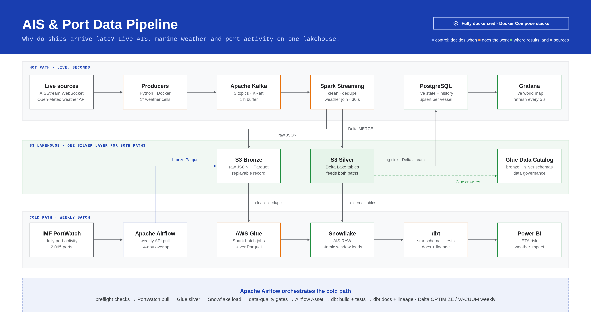
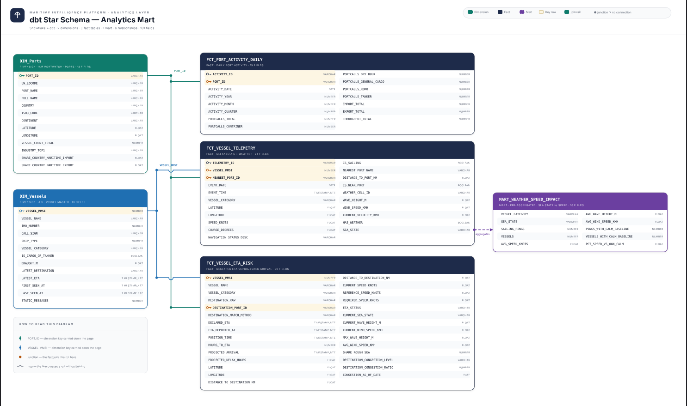

# AIS & Port Data Pipeline


## Motivation & Project Overview

Vessel position reports and port activity data are valuable for understanding
maritime movement, but they arrive from different sources and at different
cadences. AIS messages are continuous event streams, while PortWatch activity
and reference datasets are periodically refreshed. Each needs validation,
reliable storage, and a consistent analytical model before it can support
monitoring and analysis.

This project combines batch and streaming data engineering workflows to:

- Ingest PortWatch ports and chokepoints activity and reference data from
  ArcGIS services.
- Stream AIS position and vessel static messages from AISStream, and retrieve
  marine and weather data from Open-Meteo.
- Store raw and refined data in Amazon S3, using Parquet for batch inputs and
  Delta Lake tables for streaming AIS data.
- Orchestrate batch ingestion and validation with Apache Airflow and AWS Glue.
- Load curated sources into Snowflake and build analytics models with dbt.
- Serve recent vessel state and position history through PostgreSQL and a
  provisioned Grafana dashboard.

The project has two related paths: a scheduled batch warehouse pipeline and a
separate, continuously running AIS streaming stack. Cloud resources are
external dependencies; this repository does not include Terraform or another
infrastructure provisioning layer.

## Problem Description

The pipeline addresses practical challenges in maritime data processing:

- Large historical PortWatch snapshots should be downloaded and processed
  without loading the complete source file into memory.
- Recent PortWatch data can be revised, so incremental ingestion must revisit
  an overlap window and maintain a durable watermark.
- AIS messages are semi-structured and need validation, deduplication, and
  enrichment before they are useful for analytics.
- Weather measurements need to be aligned to vessel positions by a shared
  geographic cell and UTC hour.
- Repeated reporting needs tested dimensions and facts rather than direct
  querying of raw source files.

## Architecture Summary

```text
Batch:
ArcGIS PortWatch
  -> Airflow backfill / weekly ingestion
  -> S3 bronze (Parquet)
  -> AWS Glue cleaning and quality checks
  -> S3 silver (Parquet)
  -> Snowflake RAW load and data-quality checks
  -> dbt staging -> intermediate -> marts

Streaming:
AISStream + Open-Meteo
  -> Python producers
  -> Kafka topics
  -> Spark Structured Streaming
  -> S3 bronze (JSON) and silver (Delta Lake)
  -> PostgreSQL live state and position history
  -> Grafana

Snowflake also reads the AIS Delta tables in S3 through external tables.
```



*Architecture diagram: live streaming and weekly batch paths, shared S3 lake,
warehouse transformations, and BI serving.*

The AWS Glue Data Catalog tracks the batch bronze and silver datasets alongside
the streaming tables:


## Batch Ingestion & Orchestration (Airflow)

Airflow runs locally in Docker Compose using a CeleryExecutor, PostgreSQL
metadata storage, and Redis. The Airflow API/UI is available at
`http://localhost:8080`.

The current DAGs are:

- `activity_backfill`: manually triggered historical ports and chokepoints
  activity snapshot. It streams the source CSV in chunks, writes year-based
  Parquet files to S3, compares row counts with the ArcGIS service, and writes
  a snapshot marker after validation.
- `activity_weekly`: scheduled for Wednesdays at `06:00 UTC`. It re-fetches a
  14-day overlap from each activity service, pages and validates the results,
  writes Parquet data and watermarks to S3, then runs the ports Glue job,
  Snowflake loads, and data-quality checks.
- `ingest_reference_data`: monthly ports and chokepoints reference download.
  It validates the source row counts, writes Parquet to S3, verifies the
  outputs, and starts the ports-reference Glue job.
- `dbt_transform`: runs when the weekly ports and AIS data-quality tasks have
  emitted both their Airflow assets. It installs dbt packages, checks source
  freshness, then builds and tests staging/intermediate models and marts.

The ingestion DAGs run shared preflight checks for their dependencies,
including AWS identity and S3 access, Snowflake connectivity, and ArcGIS source
availability. Failed source requests, empty outputs, row-count mismatches, and
failed data quality checks fail the relevant task.

The first activity run requires `activity_backfill` to create the initial
snapshot and watermark fallback. The reference-data DAG is separate from the
weekly activity flow. Chokepoints are ingested into S3, while the current
Snowflake/dbt analytical models primarily use ports activity and AIS data.
See [airflow/README.md](./airflow/README.md) for setup and DAG details.

The Airflow graph below shows the weekly ingestion, loading, validation, and
Delta maintenance dependencies:


## Streaming Ingestion & Live Serving

The stack in [streaming/](./streaming/) is started independently with Docker
Compose:

1. The AIS producer subscribes to AISStream position and static vessel
   messages and publishes them to Kafka.
2. The weather producer finds active geographic cells from position events
   and publishes hourly Open-Meteo marine and weather observations.
3. Spark Structured Streaming writes raw Kafka records as JSON under S3
   `bronze/` and cleans them into partitioned Delta tables under `silver/`.
   Positions are deduplicated and enriched with cached weather observations
   where a matching cell and hour are available.
4. A Spark sink reads the Delta tables into PostgreSQL. It appends position
   history and upserts each vessel's latest position and static attributes.
5. Grafana is provisioned with the PostgreSQL datasource and the AIS hot-path
   dashboard.

Kafka retention is intentionally short in the local Compose configuration.
S3 bronze records and the `silver_rebuild.py` utility provide recovery and
reprocessing options, subject to the records already written to S3. Open
`http://localhost:3001` for Grafana, `http://localhost:18080` for the Spark
master UI, and `http://localhost:9092` for the local Kafka broker.

The provisioned Grafana dashboard presents the live cargo and tanker fleet,
recent position volume, and vessel status:


## Data Warehouse Design (Snowflake + dbt)

Snowflake stores raw copies of the curated S3 data in the `AIS.RAW` schema.
The SQL scripts in [snowflake/](./snowflake/) create the warehouse objects,
stages, external tables, initial tables, and incremental load procedures.
The weekly Airflow DAG calls `LOAD_PORTS_ACTIVITY(14)` and
`LOAD_AIS_DATA(14)` to refresh the recent data window.

The dbt project in [dbt/ais/](./dbt/ais/) uses an `ais` profile and organizes
models into:

- `staging`: source renaming, type normalization, deduplication, and derived
  fields.
- `intermediate`: reusable business logic, including cargo/tanker positions
  and port congestion.
- `marts`: analytical dimensions and facts in the Snowflake `AIS.MARTS`
  schema.

Current marts include:

- `dim_ports` and `dim_vessels`
- `fct_port_activity_daily`
- `fct_vessel_telemetry`, with sea state and nearest-port attributes
- `fct_vessel_eta_risk`, with destination matching and projected arrival risk
- `mart_weather_speed_impact`, comparing vessel speeds across sea states

dbt schema tests cover key uniqueness, required fields, relationships,
accepted values, and data ranges. Weather or destination details that cannot be
reliably matched remain unknown rather than being presented as verified facts.
Read [dbt/ais/README.md](./dbt/ais/README.md) for project configuration and
commands.

### Analytics Model

The diagram below shows the dbt mart entities and their relationships.



The dbt lineage view shows the source-to-model and test dependencies:


The Power BI report summarizes fleet delay, ETA risk, port congestion, and
weather impact. The report file is available at
[imgs/gpbigdata.pbix](imgs/gpbigdata.pbix).


## Repository Structure

```text
AIS-Pipeline/
├── .github/workflows/       # Airflow CI workflow
├── imgs/                    # Architecture, lineage, monitoring, and BI visuals
├── airflow/
│   ├── dags/                # Batch DAGs and shared checks
│   ├── config/dbt/          # Airflow's dbt profile
│   ├── tests/               # DAG and ArcGIS API tests
│   └── docker-compose.yaml  # Local Airflow services
├── dbt/
│   └── ais/                 # Snowflake dbt project
├── glue jobs/               # AWS Glue job definition/script exports
├── snowflake/               # Warehouse setup and load SQL
└── streaming/
    ├── producers/           # AISStream and Open-Meteo producers
    ├── spark/               # Kafka-to-Delta and Delta-to-PostgreSQL jobs
    ├── grafana/             # Dashboard and datasource provisioning
    └── tests/               # Streaming-related test utilities
```

## Setup & Reproducibility

### Prerequisites

- Docker and Docker Compose
- AWS account access, an S3 bucket, and permissions for the Airflow and Glue
  workflows
- AWS Glue jobs deployed with the expected names and arguments
- Snowflake account access and permission to create the documented database,
  schemas, stage, tables, and procedures
- A Snowflake key-pair file for dbt
- Python 3.14 and `uv` for the Airflow project and its tests
- AISStream API key for live AIS ingestion

The example configuration defaults to the `eu-north-1` AWS region and the
`g9-ais-project` bucket. Replace these values and any environment-specific
resource paths with resources you are authorized to use. The Glue job exports
also contain deployment-specific defaults and should be reviewed before
deployment.

### 1. Configure AWS and Snowflake

Create or configure the S3 bucket, IAM permissions, and Glue jobs required by
the Airflow DAGs and streaming stack. This repository does not provision those
resources automatically.

In Snowflake, review and run the SQL in order:

1. `snowflake/01_setup.sql` to create the warehouse, database, schemas, role,
   file format, and S3 stage. Replace its example user and AWS credential
   placeholders securely before execution.
2. `snowflake/02_initial_load.sql` to create and initially populate the raw
   PortWatch tables and AIS Delta external tables.
3. `snowflake/stored_procedurs.sql` to define the recent-window load
   procedures used by Airflow.

Before loading reference rows, align the `PORTS_REF` COPY prefix in
`02_initial_load.sql` with the actual output prefix configured for the
`ports_ref_silver` Glue job.

Never commit real passwords, API keys, private keys, or AWS credentials.

### 2. Run the batch pipeline

From `airflow/`, copy `.env.example` to `.env` and set your values for
`AIRFLOW_UID`, `FERNET_KEY`, AWS and Snowflake Airflow connections,
`BUCKET_NAME`, and the `DBT_SNOWFLAKE_*` variables. Put the Snowflake private
key at the configured path; the Compose file mounts the repository's ignored
`keys/` directory read-only into the containers.

```bash
cd airflow
cp .env.example .env
# Edit .env with credentials and resource names; do not commit it.
docker compose up airflow-init
docker compose up -d
```

Open [http://localhost:8080](http://localhost:8080), trigger
`activity_backfill` once, and then monitor the scheduled DAGs in the Airflow UI.
The local Compose defaults create the UI user `airflow` with password
`airflow`; change these defaults before using the deployment beyond a
disposable local environment.

### 3. Build the dbt models

Configure a local `~/.dbt/profiles.yml` with an `ais` profile and credentials
for the same Snowflake database. From `dbt/ais/`, run:

```bash
dbt deps
dbt debug
dbt source freshness
dbt build
```

The Airflow image installs the dbt executable separately from Airflow's
Python dependencies and uses the committed profile in `airflow/config/dbt/`.

### 4. Run the streaming stack

From `streaming/`, copy `.env.example` to `.env`, add your AISStream API key,
AWS credentials, region, bucket, and a strong local PostgreSQL password, then
start the services:

```bash
cd streaming
cp .env.example .env
# Edit .env; never commit credentials.
docker compose up --build -d
```

The Compose stack includes Kafka, AIS and weather producers, Spark master and
worker, the Delta streaming job, the PostgreSQL sink, and Grafana. This is a
local development setup; change default credentials and do not expose its
services publicly.

## Tests

Run the Airflow checks from `airflow/`:

```bash
cd airflow
uv sync
uv run ruff check .
uv run --group test pytest tests/ -v
```

Run the streaming unit tests from `streaming/`:

```bash
cd streaming
python -m pip install -r requirements-dev.txt
python -m pytest tests/ -v
```

GitHub Actions runs the Airflow and streaming test jobs separately when their
respective project files change. These tests do not provision AWS or Snowflake
resources or validate a live end-to-end cloud run. The S3 round-trip test is
marked as an integration test and skips by default; run it with
`RUN_S3_INTEGRATION=1` and valid AWS/S3 configuration when you want to test a
real bucket.

## Operational Notes

- Keep local `.env` files and the `keys/` directory out of version control.
- Airflow Compose is for local development, not a production deployment.
- Streaming Compose includes local-development defaults for PostgreSQL and
  Grafana; replace them and restrict network access for any shared deployment.
- S3 paths, bucket defaults, Glue job names, Snowflake objects, and IAM
  permissions must agree across the deployment configuration.
- Weekly PortWatch refreshes intentionally reload a 14-day overlap to account
  for revised source data; Snowflake load procedures replace the affected
  recent window instead of blindly appending duplicate rows.
